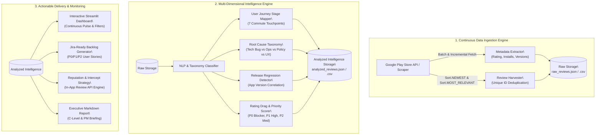

# MoveInSync Play Store Intelligence Platform: Architecture & System Design

**Role:** Forward Deployed Engineer (Intern to FTE)  
**System Objective:** Ingest, classify, prioritize, and continuously monitor Google Play Store reviews for MoveInSync (`com.moveinsync.ets`) to solve rating degradation and empower product/engineering teams to take immediate action.

---

## High-Level System Architecture



---

## 1. Component Deep-Dive

### A. Ingestion Engine (`src/scraper.py`)
- **Target App:** MoveInSync ETS Employee App (`com.moveinsync.ets`).
- **Harvesting Strategy:** Combines two complementary streams:
  1. `Sort.NEWEST`: Captures immediate release health, post-deployment regressions, and emerging client issues.
  2. `Sort.MOST_RELEVANT`: Identifies high-visibility public complaints with high thumbs-up upvotes that drive store conversion down.
- **De-duplication:** Normalized on Google Play `reviewId`.
- **Extracted Schema:**
  - `review_id` (str), `user_name` (str), `rating` (int 1-5), `content` (str), `thumbs_up` (int), `app_version` (str), `date` (ISO-8601), `developer_response` (str/null), `developer_response_date` (str/null).

---

### B. Multi-Dimensional Taxonomy Classifier (`src/analyzer.py`)

Every review is classified across 4 independent axes:

#### 1. Functional Category
* `TECH_BUG`: Client-side crashes, splash screen freezes, authentication drops, DB migrations, memory leaks.
* `TRACKING_NAVIGATION`: GPS freezing, ETA divergence from Google Maps, erratic car marker jumps, route detours.
* `COMMUNICATION_OTP`: OTP delivery latency, SMS fallback delays, driver calling / VoIP number masking failures.
* `UX_POLICY`: Mandatory unskippable rating modals, shift booking cutoff lockouts, unclear waitlist tags.
* `GROUND_OPS_DRIVER`: Driver tardiness, cab cancellations, rude behavior, AC turned off.
* `POSITIVE_EXPERIENCE`: Commuters praising smooth daily transport and reliability.

#### 2. User Journey Stage Mapping (7 Touchpoints)
1. `Roster_&_Authentication`: Login, SSO, roster sync, splash screen launch.
2. `Ride_Booking_&_Scheduling`: Self-booking, cutoffs, calendar view, waitlists.
3. `Cab_Allocation_&_Routing`: Route clustering, pickup sequencing, multi-passenger detours.
4. `Live_Tracking_&_ETA`: Map camera bounds, vehicle marker streaming, ETA countdown.
5. `Boarding_&_OTP_Verification`: OTP retrieval, passenger list, driver verification.
6. `Driver_Communication_&_Transit`: In-cab comfort, driver phone bridging, SOS/safety.
7. `Post_Trip_&_Feedback_Support`: In-app rating flow, transport desk escalation.

#### 3. Engineering Team Ownership
* `Mobile_Android_Eng`
* `Backend_Infra_Eng`
* `Routing_Algorithm_Team`
* `Product_Design_UX`
* `Fleet_Operations_Desk`

#### 4. Rating Drag Metric
Quantifies the public brand damage caused by an individual issue:
$$\text{Drag Score} = (5 - \text{Rating}) \times \left(1 + 0.5 \times \text{ThumbsUp}\right) \times \text{SeverityMultiplier}$$
Where:
- $\text{SeverityMultiplier} = 3.0$ for `P0_CRITICAL` (app launch failure, OTP boarding block)
- $\text{SeverityMultiplier} = 2.0$ for `P1_HIGH` (severe tracking lag, forced rating dialog)
- $\text{SeverityMultiplier} = 1.2$ for `P2_MEDIUM` (viewport zoom reset, laggy UI)
- $\text{SeverityMultiplier} = 0.5$ for `P3_LOW` (cosmetic suggestions)

---

### C. Continuous Pulse & Recurring Ask Capability (`app.py`)

The assignment highlights:
> *“‘How are our Play Store ratings?’ - this is a question we'll keep asking from time to time. It is not a one-time ask.”*

To make this capability enduring and reusable:
1. **Interactive Streamlit Dashboard:** Leadership and PMs can slice data by app version, star rating, and touchpoint in real time.
2. **Automated Weekly Monitoring:** The ingestion script can be attached to a scheduled GitHub Action or server cron job to update `data/analyzed_reviews.json`.
3. **Alerting on Regressions:** If a new release drops below 3.5★ or generates $>5$ launch crash complaints within 48 hours, an automated slack/email digest is triggered.

---

### D. Play Store Reputation Hack (In-App Review API Intercept)

```mermaid
sequenceDiagram
    autonumber
    actor User as Employee Commuter
    participant App as MoveInSync App
    participant Internal as Internal Transport Desk
    participant Store as Google Play Store

    User->>App: Completes Office Commute
    App->>App: Evaluate Commuter Health Criteria
    alt Commuter had negative experience (<3 stars or >15m delay)
        App->>User: "We noticed a delay. Speak with Transport Desk?"
        User->>Internal: In-app direct ticket / call
        Note over User,Internal: Problem resolved internally; user does NOT vent on Play Store!
    else Commuter completed >=5 on-time rides & 5-star driver rating
        App->>User: Trigger Google In-App Review API (Native bottom sheet)
        User->>Store: Submit 5-Star Rating in 2 taps without leaving app!
    end
```

By tapping into just 0.5% of satisfied daily commuters (~7,500 5-star reviews/month), MoveInSync can rapidly raise its Play Store rating from **4.32★ to 4.70★+**.
